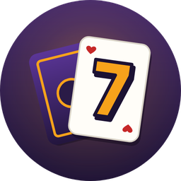
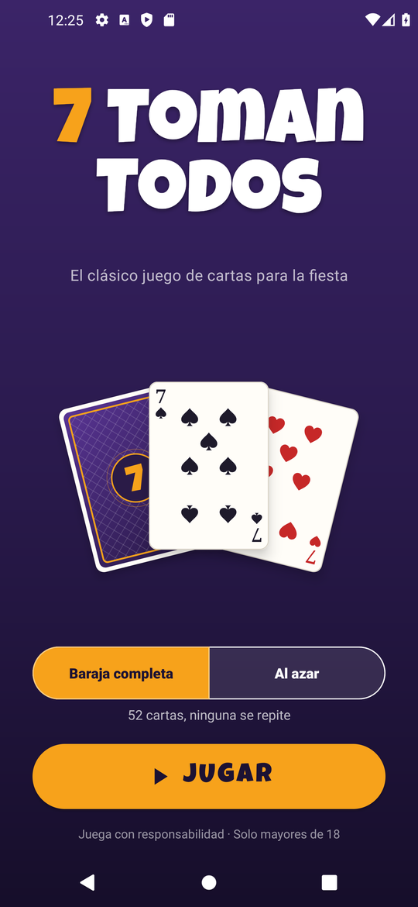
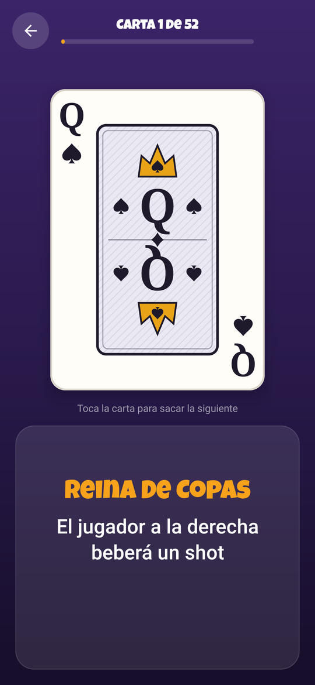
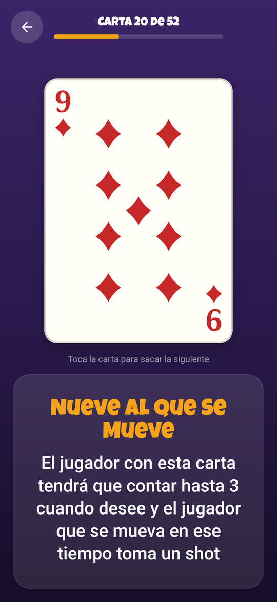
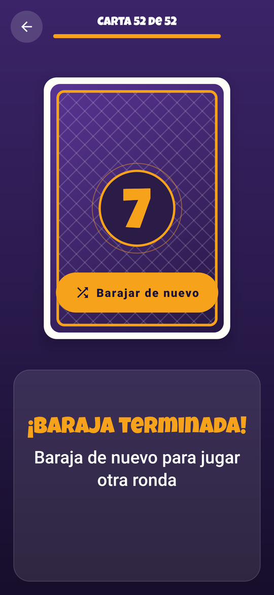
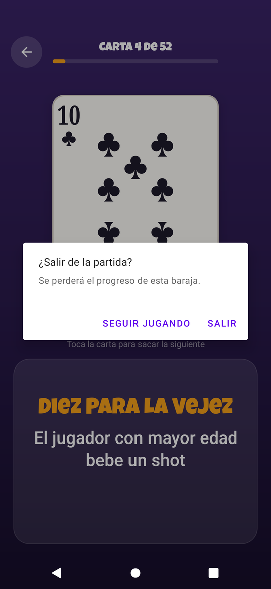
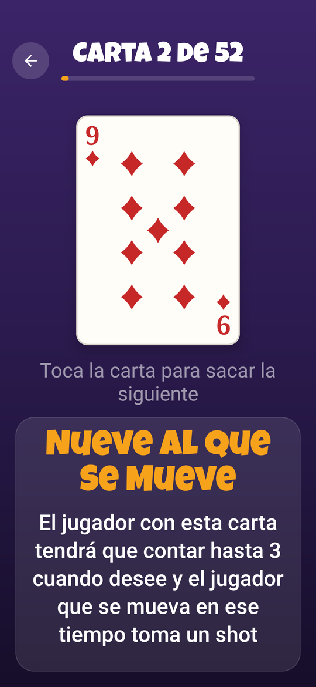
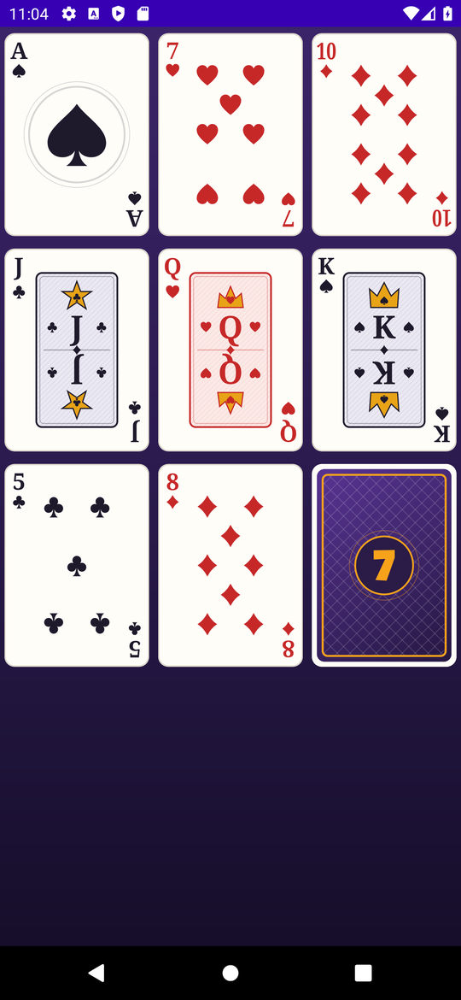
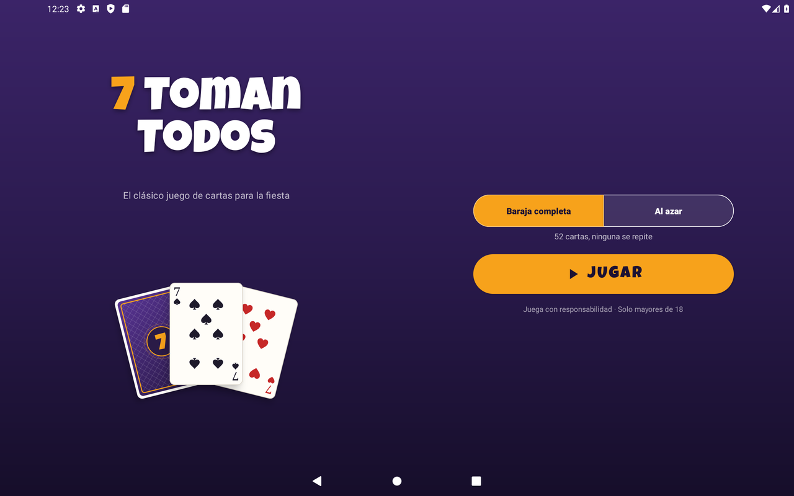
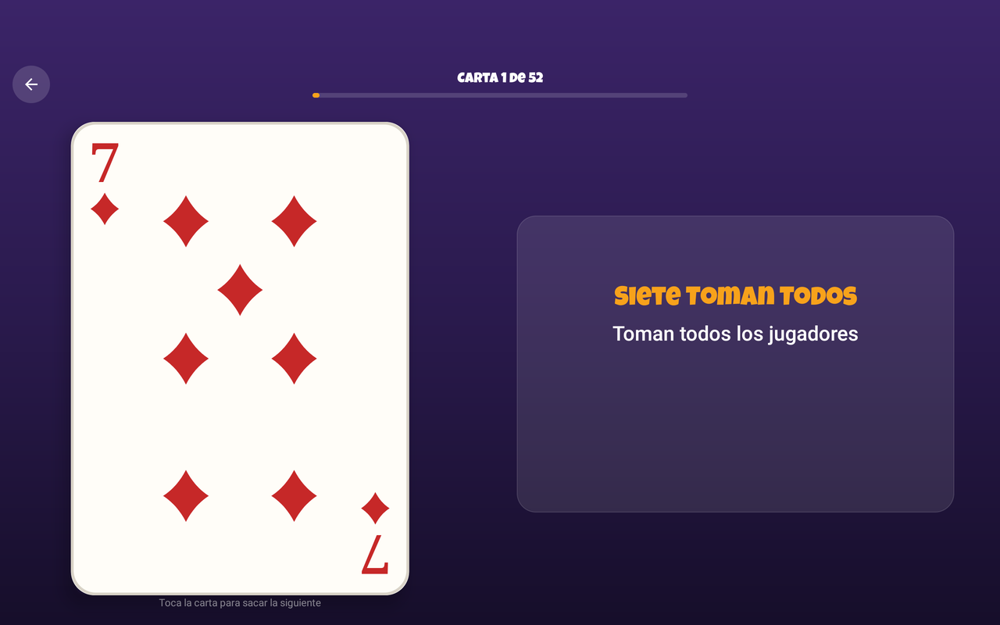

<p align="center">
  
</p>

<h1 align="center">7 Toman Todos</h1>

<p align="center">
  The classic party card game for Android: draw a card, read the rule, play.<br>
  <b>Android 8.0+ · Java · Material Components · phones, tablets and foldables</b>
</p>

<p align="center">
  
  
  
</p>

> Party game for adults (18+). Play responsibly.

## About

**7 Toman Todos** is a party card game. Each card in a standard 52-card deck has its own rule. You draw a card, the app shows its rule, and the group plays it. The app is in Spanish.

This repository is a refactor of the original app, done with an AI coding assistant. The refactor fixed gameplay bugs, rebuilt the UI, drew every card in code, made the app adaptive and accessible, and moved it to Android 16 (API 36).

## Features

- **Two game modes**
  - **Baraja completa**: the 52 cards are shuffled and each appears exactly once. A progress bar tracks the deck.
  - **Al azar**: endless random cards that can repeat.
- **Vector playing cards**: all 52 cards and the card back are drawn on a `Canvas` (`PlayingCardView`). There are pip layouts, aces, and court cards with emblems, all sharp at any size.
- **Card flip animation** with sound and haptic feedback.
- **Progress survives rotation and process death**: the deck order and position are saved in the instance state.
- **Exit confirmation**: leaving a full deck part-way through asks before throwing the game away.
- **Adaptive layouts**:
  - Phones are portrait.
  - Tablets and foldables (600dp and up) can rotate, with dedicated two-column landscape layouts.
- **Accessibility**:
  - TalkBack reads the card ("Reina de picas"), offers a "Sacar la siguiente carta" action, and announces each new rule.
  - Rule text scales with the system font size up to 2x and scrolls if needed.
- **Edge-to-edge UI**:
  - The menu keeps the system bars visible; gameplay is immersive.
  - Content stays clear of display cutouts.
- **Adaptive launcher icon** in vector form, with a monochrome layer for Android 13+ themed icons.

## Screenshots

| Deck finished | Exit confirmation | Large text (2x) | Card designs |
|:---:|:---:|:---:|:---:|
|  |  |  |  |

**Tablet (landscape)**

 

## Build and run

Requirements: Android Studio (or JDK 17 plus the Android SDK) and a device or emulator running Android 8.0 (API 26) or newer.

```bash
git clone https://github.com/Nicolas749/7-toman-todos-ia-refactor.git
cd 7-toman-todos-ia-refactor
./gradlew assembleDebug
```

The APK is written to `app/build/outputs/apk/debug/app-debug.apk`. To install it on a connected device with USB debugging enabled:

```bash
adb install -r app/build/outputs/apk/debug/app-debug.apk
```

Or open the project in Android Studio and press **Run**.

### Tests and lint

```bash
./gradlew testDebugUnitTest lintDebug
```

The unit tests cover the deck logic (`DeckTest`) and the card catalog (`CardCatalogTest`).

### Debug-only tools

Debug builds include `CardGalleryActivity` for visual review:

```bash
# All 52 cards
adb shell am start -n com.juego.siete_toman_todos/.CardGalleryActivity
# A few cards at a large size
adb shell am start -n com.juego.siete_toman_todos/.CardGalleryActivity --es mode detail
# Launcher icon preview; also writes 512 px PNGs to the app's files folder
adb shell am start -n com.juego.siete_toman_todos/.CardGalleryActivity --es mode icon
```

## Project structure

```
app/src/main/java/com/juego/siete_toman_todos/
├── MainActivity.java      Home screen: mode toggle, Jugar button, card fan
├── GameActivity.java      Game screen: draw, flip animation, rules, progress, exit guard
├── Deck.java              Shuffled deck (Fisher–Yates), full-deck and random modes, save/restore
├── CardCatalog.java       The 52 cards with their rule title and text
├── Suit.java              Card suits
├── PlayingCardView.java   Custom View that draws a card face or back on a Canvas
└── FullScreen.java        Edge-to-edge, safe-area padding, system bars, orientation
app/src/main/res/
├── layout/ , layout-land/ Portrait and landscape layouts
├── values/strings.xml     All texts in Spanish, including the card rules
└── drawable/              Vector icons, backgrounds and the adaptive launcher icon
app/src/debug/             Debug-only card gallery and icon export
app/src/test/              Unit tests
```

## Tech stack

- **Language:** Java 17
- **SDK:** compileSdk / targetSdk 36, minSdk 26
- **Libraries:** AndroidX AppCompat, Activity, Core and ConstraintLayout; Material Components
- **Fonts:** Luckiest Guy (display), Roboto (body)
- **Release build:** R8 code shrinking and resource shrinking
